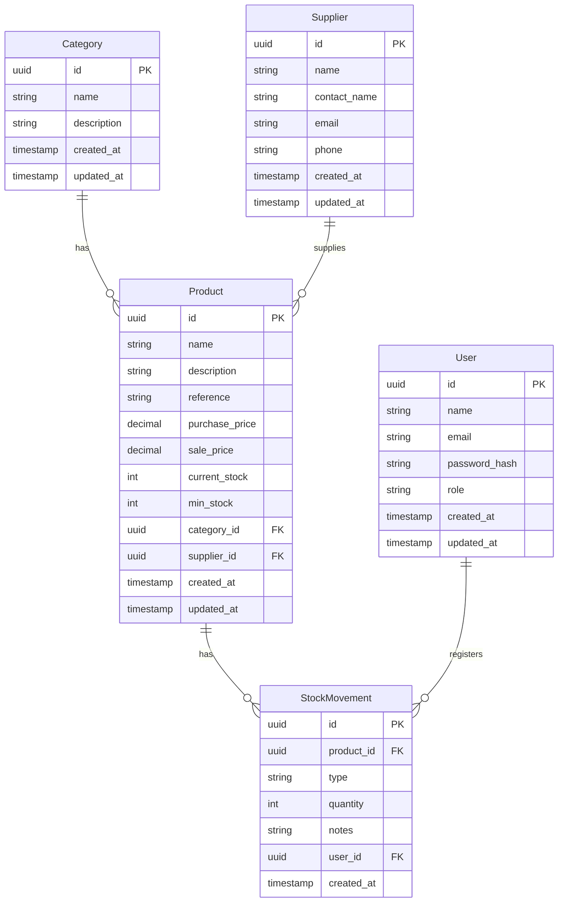

# Entity-Relationship Diagram

## Notes

- `role` values: `admin`, `operator`
- `type` values: `IN`, `OUT`, `ADJUSTMENT`
- `reference` is optional (nullable)
- All FK relations use `RESTRICT` on delete — a category or supplier cannot be deleted if it has products assigned; a product or user cannot be deleted if it has stock movements
- `StockMovement` has no `updated_at` — movements are immutable
