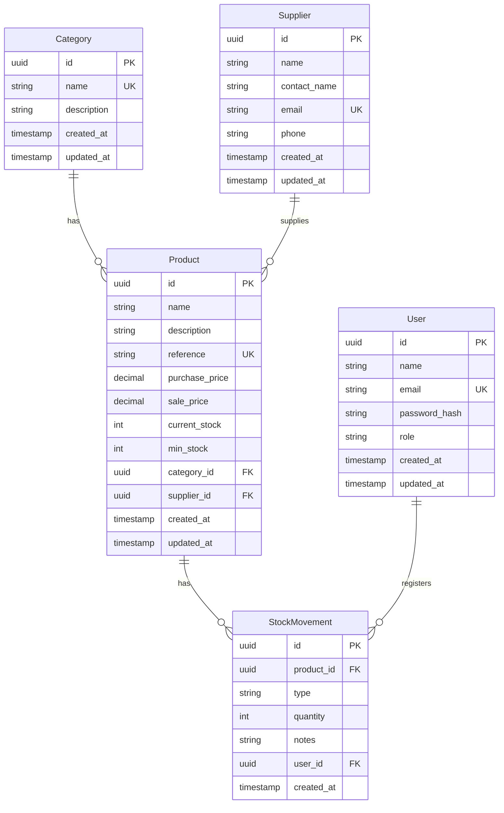

# Diagrama entidad-relación

## Notas

- Valores de `role`: `ADMIN`, `OPERATOR`
- Valores de `type`: `IN`, `OUT`, `ADJUSTMENT`
- `reference` es opcional (puede ser nula) y única cuando tiene valor (dos productos no pueden compartirla)
- Todas las claves foráneas usan `RESTRICT` al borrar: no se puede borrar una categoría o un proveedor con productos asignados, ni un producto o un usuario con movimientos de stock
- `StockMovement` no tiene `updated_at`: los movimientos no se modifican una vez creados
